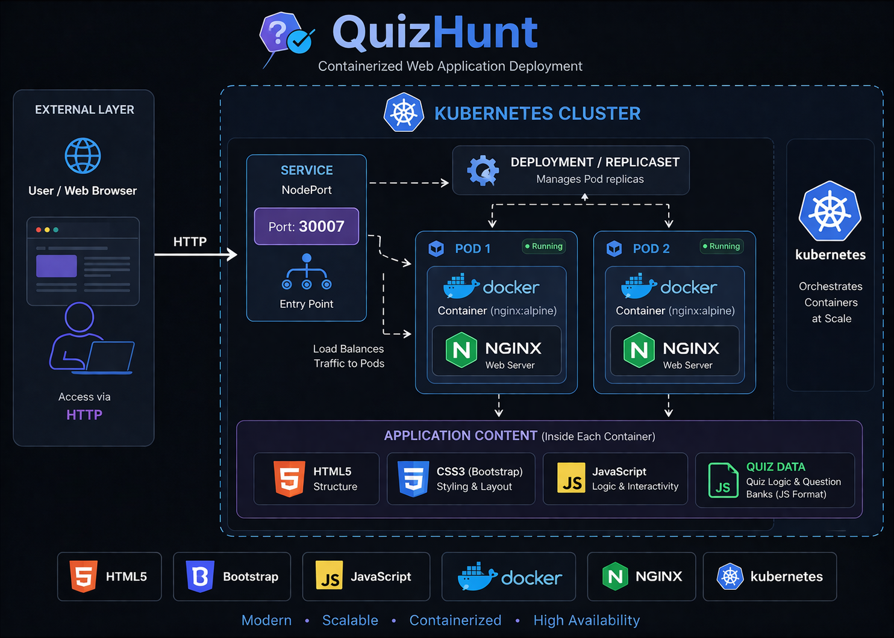

# 🎯 QuizHunt — Next-Gen Programming Quiz Platform

QuizHunt is an interactive, web-based platform designed to test your knowledge across multiple programming languages and core computer science concepts. Now upgraded with a **professional DevOps stack** including Docker, Kubernetes, CI/CD, **Terraform**, and **Ansible** for fully automated cloud deployment.



## 🚀 Features & Infrastructure
- **🐳 Dockerized**: Fully containerized using Nginx for high-performance static serving.
- **🎡 Kubernetes Ready**: Includes deployment manifests with 2 replicas and automated load balancing.
- **⚙️ CI/CD Pipeline**: Automated testing, Docker Hub push, and cloud deployment via GitHub Actions.
- **🏗️ Terraform IaC**: Infrastructure as Code for AWS EC2 provisioning with modular configuration.
- **🔧 Ansible Automation**: Role-based configuration management for server setup and app deployment.
- **📚 15+ Categories**: Quizzes on C, C++, Java, Python, Linux, OS, DBMS, ML, and more.
- **📊 Real-time Scoring**: Instant feedback and score tracking.

## 🛠️ Technologies Used
- **Frontend**: HTML5, CSS3, Bootstrap 4, JavaScript (Vanilla)
- **DevOps**: Docker, Kubernetes (K8s), GitHub Actions (YAML)
- **IaC**: Terraform (AWS Provider)
- **Config Management**: Ansible (Role-based Playbooks)
- **Cloud**: AWS EC2, Security Groups
- **Web Server**: Nginx (Alpine)

## 🏗️ System Architecture

The project follows a modern DevOps architecture:

1. **Source Code** is pushed to GitHub.
2. **GitHub Actions** triggers a CI pipeline to build, test, and push Docker image to Docker Hub.
3. **Terraform** provisions an AWS EC2 instance with security groups.
4. **Ansible** configures the server (installs Docker, pulls image, runs container).
5. **Application** becomes accessible via the EC2 public IP.

```
Developer → GitHub → CI/CD Pipeline → Docker Hub
                                          ↓
                     Terraform → AWS EC2 Instance
                                          ↓
                     Ansible → Docker Container → Live App
```

## 📁 Project Structure

```
QuizHunt/
├── terraform/                    # Infrastructure as Code
│   ├── main.tf                   # AWS provider, EC2, security groups
│   ├── variables.tf              # Input variables
│   ├── outputs.tf                # Public IP, app URL outputs
│   ├── backend.tf                # Remote state config (optional)
│   └── terraform.tfvars.example  # Example variable values
├── ansible/                      # Configuration Management
│   ├── inventory.ini             # Server inventory (auto-generated)
│   ├── playbook.yml              # Main orchestration playbook
│   └── roles/
│       ├── common/tasks/main.yml # System updates & prerequisites
│       ├── docker/tasks/main.yml # Docker Engine installation
│       └── app/                  # Application deployment
│           ├── tasks/main.yml    # Pull & run container
│           └── defaults/main.yml # Default variables
├── .github/workflows/ci-cd.yml  # Full CI/CD pipeline
├── Dockerfile                    # Nginx-based container
├── k8s-deployment.yaml           # Kubernetes manifests
├── deploy.sh                     # One-command deploy script
└── index.html                    # Application entry point
```

## 🏁 Getting Started

### Prerequisites

| Tool | Version | Installation |
|------|---------|-------------|
| Terraform | v1.0+ | [Install Terraform](https://developer.hashicorp.com/terraform/tutorials/aws-get-started/install-cli) |
| Ansible | v2.9+ | `pip install ansible` |
| AWS CLI | v2 | [Install AWS CLI](https://docs.aws.amazon.com/cli/latest/userguide/getting-started-install.html) |
| Docker | v20+ | [Install Docker](https://docs.docker.com/get-docker/) |

### 1️⃣ Local Development
Simply open `index.html` in your browser.

### 2️⃣ Docker (Local)
```bash
docker build -t quizhunt-app .
docker run -d -p 8080:80 quizhunt-app
# Visit http://localhost:8080
```

### 3️⃣ Kubernetes (Local)
```bash
kubectl apply -f k8s-deployment.yaml
```

### 4️⃣ Cloud Deployment (Terraform + Ansible)

#### Step 1: Configure AWS Credentials
```bash
aws configure
# Enter your AWS Access Key ID, Secret, and region (us-east-1)
```

#### Step 2: Create an EC2 Key Pair (if needed)
```bash
aws ec2 create-key-pair --key-name quizhunt-key --query 'KeyMaterial' --output text > ~/.ssh/quizhunt-key.pem
chmod 400 ~/.ssh/quizhunt-key.pem
```

#### Step 3: Configure Terraform Variables
```bash
cd terraform
cp terraform.tfvars.example terraform.tfvars
# Edit terraform.tfvars with your values:
#   key_name           = "quizhunt-key"
#   ssh_private_key_path = "~/.ssh/quizhunt-key.pem"
#   dockerhub_username = "your-username"
```

#### Step 4: Deploy (One Command)
```bash
cd ..   # Back to project root
chmod +x deploy.sh
./deploy.sh
```

Or deploy step-by-step:
```bash
# Provision infrastructure
cd terraform
terraform init
terraform plan
terraform apply

# Configure server and deploy app
cd ../ansible
ansible-playbook -i inventory.ini playbook.yml

# Get the app URL
cd ../terraform
terraform output app_url
```

#### Step 5: Access the Application
Open `http://<EC2_PUBLIC_IP>` in your browser.

#### Step 6: Tear Down (when done)
```bash
cd terraform
terraform destroy
```

## ⚙️ CI/CD Pipeline (GitHub Actions)

The pipeline runs automatically on push to `main`:

| Job | Description |
|-----|-------------|
| `build-and-test` | Builds Docker image and runs health check |
| `push-to-dockerhub` | Pushes image to Docker Hub with `latest` and SHA tags |
| `deploy-to-aws` | Provisions EC2 via Terraform, configures via Ansible |

### Required GitHub Secrets

| Secret | Description |
|--------|-------------|
| `DOCKERHUB_USERNAME` | Docker Hub username |
| `DOCKERHUB_TOKEN` | Docker Hub access token |
| `AWS_ACCESS_KEY_ID` | AWS access key |
| `AWS_SECRET_ACCESS_KEY` | AWS secret key |
| `EC2_KEY_NAME` | Name of AWS EC2 key pair |
| `EC2_SSH_PRIVATE_KEY` | Contents of the private key file |

## 🤝 Contributions
We welcome contributions! Please check the [CONTRIBUTE.md](./CONTRIBUTE.md) for guidelines on how to add new MCQ questions.

---
*Built for developers, by developers. Powered by DevOps.* 🚀
